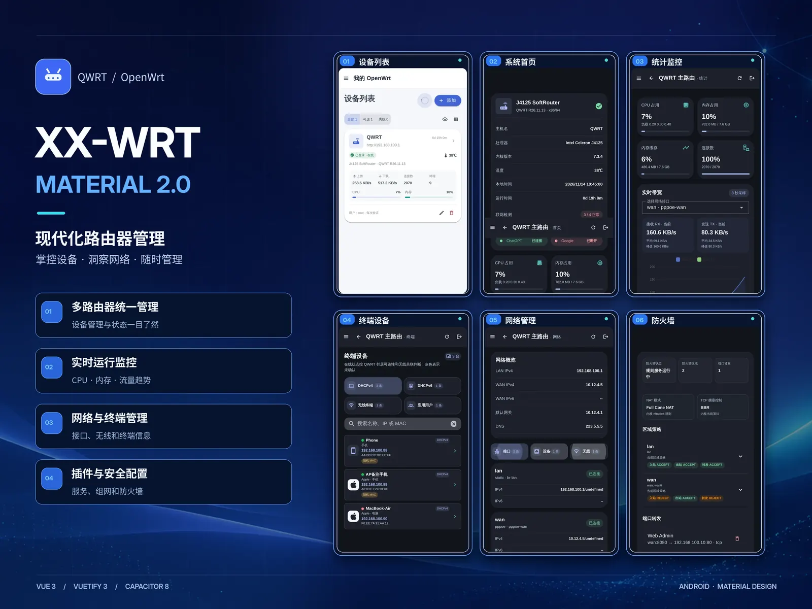
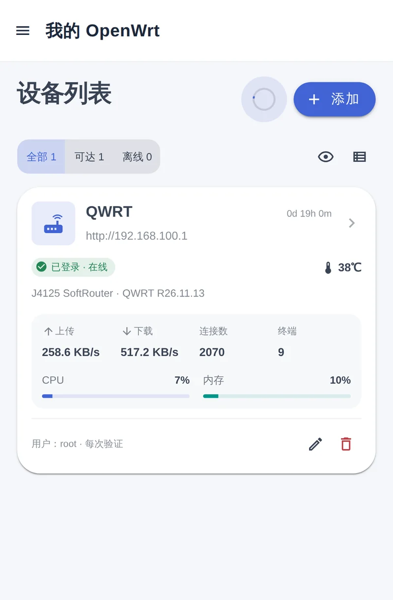
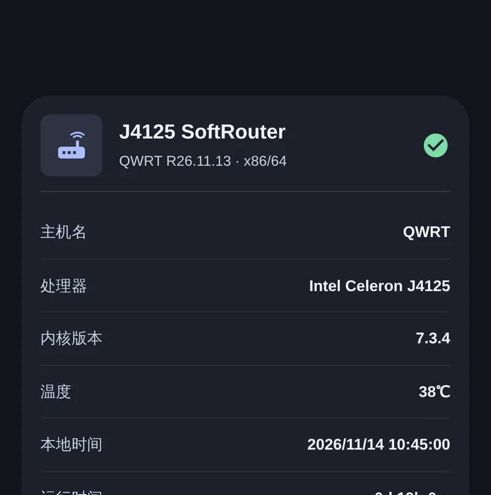
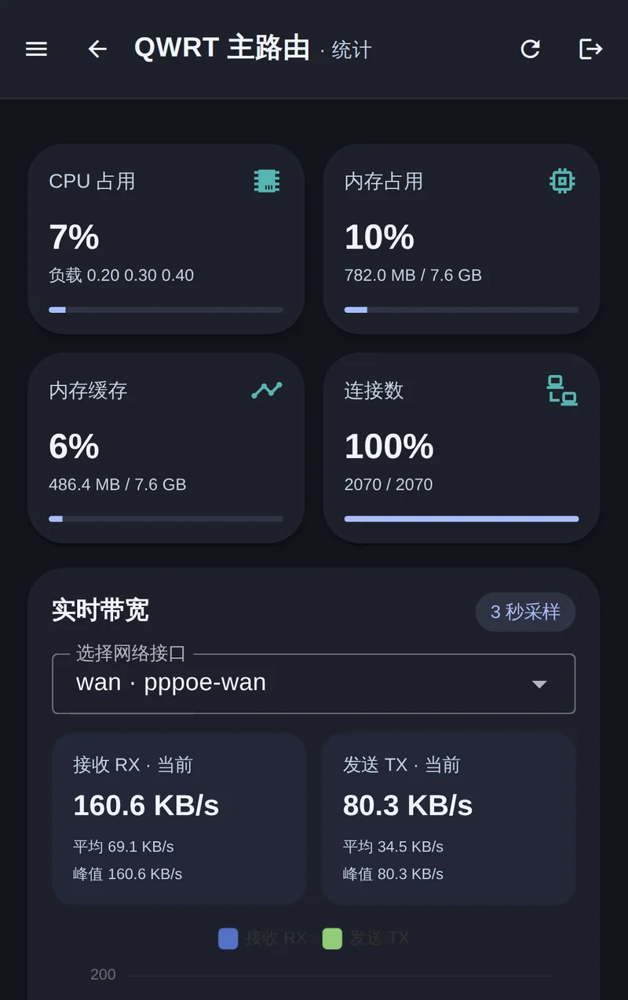
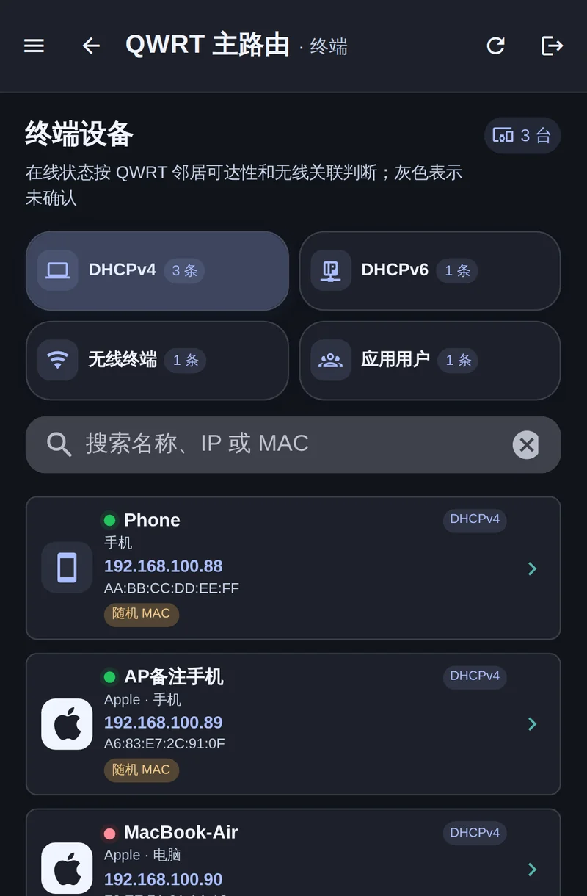
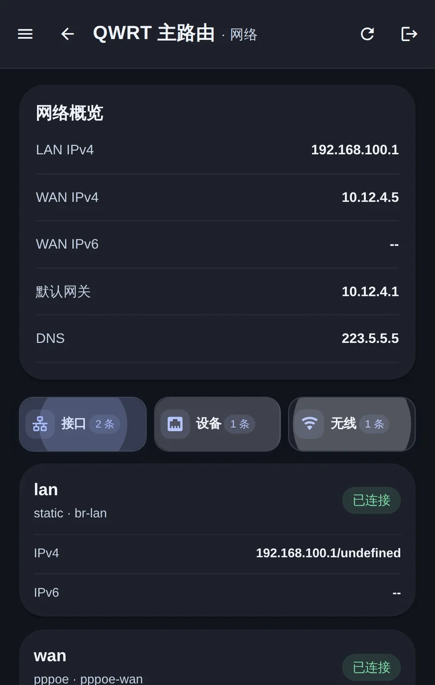
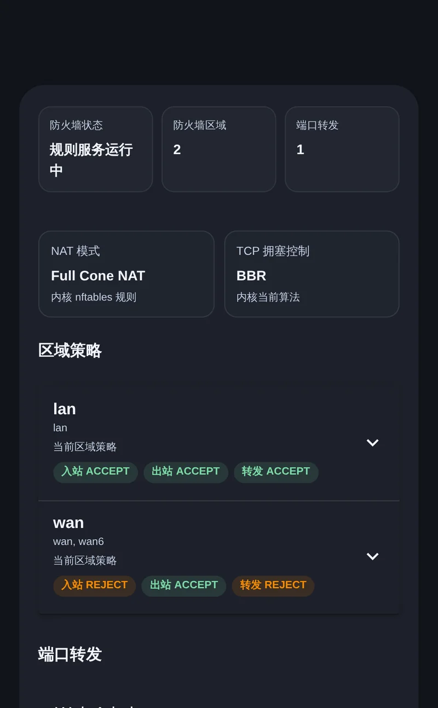

# XX-WRT Material

**面向 QWRT / OpenWrt 的 Android 路由器管理应用**。提供多设备管理、系统监控、终端与网络信息查看，以及常用路由器服务和插件的集中管理。界面基于 Material Design，支持标准与 Liquid Glass 两种底部导航样式。

项目当前以 **Material 2.0** 为主线，应用通过路由器的 **ubus JSON-RPC、UCI 及已授权的插件接口**获取数据和执行操作。可用功能取决于路由器固件、已安装插件和 RPC 权限。

## 项目宣传图

[](docs/screenshots/material-2.0-poster-full.webp)

> 由当前 Material 2.0 的六张界面截图组合制作。截图中的路由器、终端及网络指标为 UI 测试示例数据。点击海报可查看高清原图；也可在下方[界面预览](#界面预览)查看各页面截图。

## 版本信息

| 项目 | 当前配置 |
| --- | --- |
| 应用版本 | **2.0.13** |
| Android `versionCode` | `2000013` |
| 应用名称 | `XX-WRT管理器` |
| Android 包名 | `com.lmdbot.xxwrt.materialpreview` |
| 技术栈 | Vue 3 · Vite 7 · Vuetify 3 · Capacitor 8 · ECharts 5 |
| 主线分支 | `main` |
| 开发预览分支 | `feature/material-ui` |

> 当前应用保留 Material 版本独立的应用名称、包名和图标，可以与此前不同包名的版本并存安装。版本信息以实际 APK 为准。

## 界面预览

以下图片来自当前 Material 2.0 的 Playwright UI 自动化测试。**路由器地址、设备名称及各项指标为测试示例数据**，截图用于展示应用界面。

| 设备列表 | 系统首页 | 统计监控 |
| :---: | :---: | :---: |
| [](docs/screenshots/devices.webp) | [](docs/screenshots/overview.webp) | [](docs/screenshots/statistics.webp) |
| **终端设备** | **网络管理** | **防火墙** |
| [](docs/screenshots/clients.webp) | [](docs/screenshots/network.webp) | [](docs/screenshots/firewall.webp) |

点击图片可查看对应截图。

## 功能概览

### 主要页面

| 页面 | 功能 |
| --- | --- |
| **设备列表** | 添加、编辑、删除和切换多台路由器；可达/离线筛选；卡片或列表布局；查看已认证设备的主要运行指标 |
| **首页** | 系统与固件信息、CPU、内存、缓存、连接数、温度、运行时间、磁盘与临时空间、以太网接口状态及联网检测 |
| **统计** | 通过实际接口计数器计算 RX/TX 速率并绘制趋势图；显示当前、平均和峰值流量，以及 1/5/15 分钟系统负载 |
| **终端** | DHCPv4、DHCPv6、无线关联终端、OpenAppFilter 应用用户分类；搜索与终端信息展示；结合可用的邻居、无线及插件数据判断在线状态 |
| **网络** | LAN/WAN/WAN6、IPv4/IPv6、IPv6-PD、网关、DNS、MTU、路由信息；以太网设备、网桥端口、收发流量及无线参数 |

统计数据在连接期间持续采样；实时速率需要至少两次有效计数器采样，历史曲线不跨应用会话长期保存。部分指标依赖对应固件 RPC 或硬件传感器。

### 应用与路由器管理

| 功能模块 | 当前提供的主要能力 |
| --- | --- |
| **家长控制 / OpenAppFilter** | 查看运行状态，配置应用分类、时间策略、终端规则与部分高级选项 |
| **路由表、进程、启动项** | 查询路由及系统进程、服务启动与运行信息；提供相应筛选和详情展示 |
| **网络唤醒（WOL）** | 管理唤醒目标、查看网络邻居，向可用目标发送唤醒指令 |
| **ShadowSocksR Plus+** | 查询服务状态、节点及组件信息，切换代理节点、探测节点、执行授权的服务操作和组件更新 |
| **微信推送** | 管理常见通知渠道、告警及定时设置，查看设备信息、发送测试推送与编辑 DIY JSON |
| **OpenClash** | 查看服务状态并管理开关、运行/代理模式及部分网络选项 |
| **Internet Detector** | 读取联网检测实例与状态，并执行支持的服务操作 |
| **Carbon 主题** | 切换 LuCI 主题，检查更新并执行支持的更新操作 |
| **ZeroTier** | 管理服务与已配置网络，查看节点、虚拟网卡、网络连接及分配地址等可获取的信息 |
| **防火墙** | 查看区域策略、规则、端口转发和 NAT/拥塞控制信息；支持部分规则与转发管理及重载 |
| **设备维护** | 设备重启；恢复出厂需要明确二次确认 |

未安装的可选插件可能不显示入口。涉及配置写入、服务重启或规则变更的功能，需要路由器开放相应权限；权限不足时会提示不可用，不会模拟执行成功。

### 界面与交互

- 浅色、深色及跟随系统的主题模式；标准 Material / Liquid Glass 底部导航可切换。
- 设备列表设置侧栏按 **路由器、显示、隐私、刷新、实验室、关于** 分类。
- 可独立隐藏设备名称和 IP/域名；显示偏好与布局偏好保存在本机。
- 终端分类使用宫格导航，网络分类使用紧凑卡片，适配移动端触控和窄屏。
- Android 返回操作优先关闭当前弹窗或子页面；位于底部页签根页面时返回设备列表。

## 安装与连接

1. 前往 [Releases](https://github.com/lmdbot/xxwrt-m-custom/releases) 获取对应版本的 Android APK 并安装；也可以在 [Actions](https://github.com/lmdbot/xxwrt-m-custom/actions/workflows/ui-android-preview.yml) 的成功构建中下载 APK Artifact。
2. 确保 Android 手机可访问目标 QWRT/OpenWrt 路由器（局域网 Wi-Fi、VPN 等）。
3. 添加路由器，填写设备名称、地址、用户名和密码。地址支持 `http://192.168.100.1`、`http://192.168.100.1:端口` 或可信 HTTPS 域名；只填写服务根地址，不添加 `/ubus` 路径。
4. 登录成功后，进入 **首页 / 统计 / 终端 / 网络 / 应用** 页面读取设备数据与管理功能。

应用通过路由器的 `/ubus` 接口建立会话。路由器需具备可用的 `rpcd`、相应的 ubus 对象与访问权限；不同固件及插件版本返回的数据可能不同。

**账号与通信安全：** 设备地址、名称及用户名等配置保存在本机；只有用户选择记住密码时，才会在 Android 上使用安全存储保存密码。HTTP 连接可能以明文传输凭据，建议仅在可信局域网中使用；远程访问优先采用 VPN 或有效证书的 HTTPS，避免将 `/ubus` 直接暴露到公网。

## 开发与构建

### 本地运行

建议使用 **Node.js 22**。前端工程位于 `ui/material-prototype/`：

```bash
cd ui/material-prototype
npm install --no-audit --no-fund
npm run dev
```

常用验证命令：

```bash
npm run build
npx playwright install chromium
npm run test:ui
```

浏览器预览用于界面开发和交互验证；Android 安全存储、原生 HTTP 行为以及实际路由器权限仍需在 Android 真机环境测试。

### Android APK 构建与发布

仓库通过 [XX-WRT Material Android APK](https://github.com/lmdbot/xxwrt-m-custom/actions/workflows/ui-android-preview.yml) 工作流构建 Android 安装包，流程包含前端构建、Playwright UI 测试、Capacitor Android 工程生成、Gradle Release 编译、APK 签名及校验。

- **触发方式：** 手动运行工作流，或向 `main` / `feature/material-ui` 推送命中 `ui/material-prototype/**`、工作流文件的变更。
- **构建环境：** Node.js 22、Java 21、Android SDK Platform 36 / Build Tools 35.0.0。
- **Actions Artifact：** `XX-WRT-M-Material-Preview-APK`；APK 文件名为 `XX-WRT-M-Material-QWRT-v2.0.0.apk`。
- **Release：** `main` 对应 `v2.0.0` 正式发布；`feature/material-ui` 对应 `material-wrt-v2.0.0` 预发布。成功构建时，工作流会创建或更新对应 Release 附件。

签名依赖仓库 **Settings → Secrets and variables → Actions** 中的以下 Secrets：

| Secret | 用途 |
| --- | --- |
| `XXWRT_KEYSTORE_BASE64` | PKCS#12（`.p12`）签名文件的 Base64 内容 |
| `XXWRT_KEYSTORE_PASSWORD` | 签名文件及密钥密码 |

工作流使用的密钥别名为 `xxwrt`。**不要将签名文件、密码或其 Base64 内容提交到仓库。** 未配置所需 Secrets 时，APK 签名步骤会失败。

## 项目目录

```text
.github/workflows/          # Android 构建、前端验证等 GitHub Actions
ui/material-prototype/      # Material 2.0 主线前端与 Capacitor 配置
  src/App.vue               # 页面、导航和主要交互
  src/components/           # 设备卡片、终端、网络与插件管理组件
  src/services/             # 设备管理、ubus RPC、统计及设备识别
  tests/                    # Playwright UI 自动化用例
docs/                       # 功能对照、版本和变更说明
router/                     # 路由器侧辅助脚本
src/www/                    # 早期版本的前端维护资源
scripts/                    # 早期版本维护及辅助脚本
vendor/                     # 早期版本构建所需资源
```

Material 2.0 的 Android 主线使用 `ui/material-prototype/` 及 `ui-android-preview.yml`。`build-apk.yml` 保留为旧版手动构建工作流，不参与 Material 主线的自动发布。

## 兼容性与验证说明

- 核心数据取自实际路由器响应；**“不可用”“未知”“待确认”不等同于服务故障**，也可能是缺少插件、固件接口差异或 RPC 权限不足。
- DHCP 租约和历史设备提示不能单独证明终端在线；APP 使用可获取的网络邻居、无线关联和插件检测信息辅助判断。
- 目前的 Playwright 测试使用模拟 ubus 响应验证主要 UI、交互和 RPC 调用路径，**不等同于所有 QWRT/OpenWrt 固件及插件已完成真机兼容测试**。
- 部分高级功能（例如完整终端访问历史、全部插件配置能力及完整多语言内容）仍有覆盖差异，具体以当前应用界面和代码为准。
- 修改防火墙区域策略、网络服务或恢复出厂可能中断管理连接；建议事先保留本地或其他可靠的访问方式。

更多功能边界与测试范围见 [功能对照文档](docs/material-main-feature-parity.md)，界面工程说明见 [Material UI README](ui/material-prototype/README.md)。

## 开源致谢

感谢以下开源项目及其维护者。此处依据 `ui/material-prototype/package.json` 梳理 **Material 2.0 主线直接依赖**；“运行依赖”参与 APP 的界面或原生能力，“开发依赖”用于构建与测试。版本以当前配置为准，实际 APK 还可能包含传递依赖及 Android 原生依赖。

| 开源项目 | 当前依赖版本 | 项目用途 | License |
| --- | --- | --- | --- |
| [Vue.js](https://github.com/vuejs/core) | `vue@3.5.22` | 响应式界面与组件框架 | [MIT](https://github.com/vuejs/core/blob/main/packages/vue/LICENSE) |
| [Vuetify](https://github.com/vuetifyjs/vuetify) | `vuetify@3.13.7` | Material Design UI 组件 | [MIT](https://github.com/vuetifyjs/vuetify/blob/master/packages/vuetify/LICENSE.md) |
| [Material Design Icons / Pictogrammers](https://github.com/Templarian/MaterialDesign-Webfont) | `@mdi/font@7.4.47` | 应用内图标与图标字体 | [Apache-2.0（图标及字体）](https://github.com/Templarian/MaterialDesign/blob/master/LICENSE) |
| [Apache ECharts](https://github.com/apache/echarts) | `echarts@5.6.0` | 网络流量、系统负载等可视化图表 | [Apache-2.0](https://github.com/apache/echarts/blob/master/LICENSE) |
| [vue-liquid-glass](https://github.com/Daisigu/vue-liquid-glass) | `@daisigu/vue-liquid-glass@1.0.4` | Liquid Glass 导航视觉效果 | [MIT](https://github.com/Daisigu/vue-liquid-glass#license) |
| [Capacitor](https://github.com/ionic-team/capacitor) | `@capacitor/{core,android,app,browser}@8.0.0` | Android 应用容器、原生生命周期和浏览器能力 | [MIT](https://github.com/ionic-team/capacitor/blob/main/core/LICENSE) |
| [Capacitor Secure Storage](https://github.com/aparajita/capacitor-secure-storage) | `@aparajita/capacitor-secure-storage@8.0.1` | Android 本地安全存储 | [MIT](https://github.com/aparajita/capacitor-secure-storage/blob/main/LICENSE) |
| [Vite](https://github.com/vitejs/vite) / [@vitejs/plugin-vue](https://github.com/vitejs/vite-plugin-vue) | `vite@7.3.8` / `@vitejs/plugin-vue@6.0.0` | 前端开发服务器、Vue 编译与构建（开发依赖） | [MIT](https://github.com/vitejs/vite/blob/main/LICENSE) / [MIT](https://github.com/vitejs/vite-plugin-vue/blob/main/packages/plugin-vue/LICENSE) |
| [Playwright](https://github.com/microsoft/playwright) | `@playwright/test@1.65.0` | UI 自动化与交互回归测试（开发依赖） | [Apache-2.0](https://github.com/microsoft/playwright/blob/main/LICENSE) |

本项目也感谢 **[OpenWrt](https://openwrt.org/)**、LuCI、ubus/rpcd 生态及相关插件社区。应用会通过路由器授权接口与 ShadowSocksR Plus+、OpenClash、OpenAppFilter、ZeroTier、Lucky、Internet Detector 等设备端功能交互。**接口适配不代表这些软件被打包进 APK 或由本项目再分发**；其著作权、商标与 License 均以各上游项目及具体版本为准。

## License 声明

- **本项目自身：** 截至本次整理，仓库根目录尚无统一的 `LICENSE` 文件，也未确认适用于整个 XX-WRT Material 项目源代码、文档和美术资源的统一开源许可证。本节是许可状态说明，**不构成对本项目自身代码的 MIT、Apache-2.0 或其他许可证授权**。仓库公开可读不等同于允许任意复制、修改、再发布；如需明确开放衍生或再分发权限，应由项目维护者确定许可方案并添加相应 `LICENSE` 文件。
- **第三方软件：** 上表所列项目保留各自的版权、许可证和免责条款；使用本项目不改变这些上游许可证，也不意味着上游作者认可或背书本项目。
- **再分发与合规：** 当分发包含第三方代码、图标字体或原生库的源码与 APK 时，应按实际打包版本保留适用的版权和许可证文本，并遵守 MIT 的版权与许可声明保留要求，以及 Apache-2.0 的许可证、修改说明和适用的 `NOTICE` 要求。请以对应组件实际分发物中的声明为准。
- **覆盖范围：** 上表是 Material 2.0 的**直接依赖致谢清单**，不是完整的软件物料清单（SBOM）或法律合规审计；传递依赖、Android SDK/AndroidX、原生 Gradle 依赖及仓库早期 `vendor/`、`src/www/` 资源需要在正式对外再分发前另行核查。
- **图标与素材：** 本项目界面截图、宣传图和定制 APP 图标不因使用开源 UI 框架而自动采用相同的许可证；其权利与授权范围应单独确认。

## 参与改进

欢迎通过 [Issues](https://github.com/lmdbot/xxwrt-m-custom/issues) 反馈问题。建议附上 APP 版本、QWRT/OpenWrt 固件版本、插件版本、相关页面和复现步骤；请勿公开路由器密码、会话令牌及其他敏感配置。
