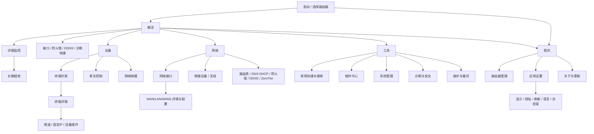

# 02 · 信息架构与导航

## 1. 核心原则

1. **先选路由器，再管理路由器**：路由器选择器始终处于顶部；终端“设备”不再承载路由器配置列表。
2. **主导航不承载详情**：五个底栏是常驻工作区根；详情标题与系统返回位于顶部工具栏。
3. **一个功能只有一个目录归属**：入口跨页调用可以存在，但不会复制出第二套功能页。
4. **单向下钻 + 精确返回**：打开页时记录 `originTab`、`originRoute`、`scrollY` 和本路由器 `deviceId`。
5. **读/写状态并列清晰**：列表查看层→可编辑详情→保存与验证，不把编辑控件直接堆在列表首屏。

## 2. 信息架构图



## 3. 五个底栏的边界

| 底栏 | 用户要解决的问题 | 包含 | 不包含 |
| --- | --- | --- | --- |
| 概览 | 现在路由器健康吗？ | 运行状态、资源、简化流量、必要快捷、详细监控 | 复杂 UCI 编辑长表单 |
| 设备 | 谁在使用网络？能对谁做什么？ | 终端搜索/详情、家长控制、网络唤醒 | 已保存路由器账户列表 |
| 网络 | 网络是怎样连接与配置的？ | WAN/LAN/IPv6/无线、DNS/DHCP、路由、防火墙、DDNS、ZeroTier | 软件包/更新管理 |
| 工具 | 要维护或诊断什么服务？ | 收藏/搜索、插件中心、系统管理、安全诊断、备份维护 | 全局 APP 设置 |
| 我的 | APP 和路由器档案怎么管理？ | 路由器选择/编辑、登录会话、主题/隐私、版本更新、关于 | 终端运行信息 |

## 4. 页面层级（具体路由建议）

```text
AppShell
├─ RouterPicker [全局; 无会话时打开路由器列表/添加]
├─ /overview
│  ├─ /monitor [实时曲线、接口切换、负载]
│  │  └─ /trends [30天有效采样；本地数据]
│  └─ shortcuts → 对应单一功能详情
├─ /devices
│  ├─ /clients?source=all|dhcp4|dhcp6|wireless|oaf
│  │  └─ /clients/:id [证据/地址/租约/受控操作]
│  ├─ /parental [基础/应用规则/时间/高级]
│  └─ /wol [已保存目标/邻居]
├─ /network
│  ├─ /interfaces → /interfaces/:name [状态/配置]
│  ├─ /hardware [有线/网桥]
│  ├─ /wireless [只读参数]
│  ├─ /routes
│  ├─ /dns-dhcp
│  ├─ /firewall [概览/区域/规则/端口转发]
│  ├─ /ddns
│  └─ /zerotier
├─ /tools
│  ├─ /favorites [最多五个；每台路由器独立]
│  ├─ /plugins [SSR/OpenClash/Lucky/微信推送/Vlmcsd/Detector/Carbon]
│  ├─ /system [软件包/服务/进程/启动项/Cron]
│  ├─ /diagnostics [Ping/Traceroute/DNS/日志/安全/审计/能力]
│  └─ /maintenance [备份恢复/重启/恢复出厂]
└─ /me
   ├─ /routers [保存列表/新增/编辑/移除/切换/退出登录]
   ├─ /settings [显示/隐私/刷新/语言/实验室]
   └─ /about [版本/更新/开发者/仓库/反馈/许可/免责声明]
```

这里的路径是**目标信息架构的设计标识**，不是宣称 `main` 已使用 Vue Router；现有 `App.vue` 通过状态变量控制主/子页面。实施可用轻量导航栈先替代部分状态组合，避免一次性重写数据服务。

## 5. 导航行为表

| 当前 | 用户动作 | 目标 | 返回应到 |
| --- | --- | --- | --- |
| 概览 | 点击“详细监控” | 详细监控 | 概览当前滚动位置 |
| 概览 | 点击防火墙快捷 | 防火墙 | 概览，不跳到工具首页 |
| 设备 | 点击终端 | 终端详情 | 保留筛选/关键词/列表位置的设备 |
| 设备 | 家长控制 | 家长控制工作区 | 设备 |
| 网络 | 点击接口 | 接口列表 | 网络 |
| 网络 | 点击 WAN6 | 接口详情 | 接口列表 |
| 网络 | 点击防火墙 | 防火墙 | 网络 |
| 工具 | 点击插件 | 插件详情 | 工具原分类列表 |
| 我的 | 点击显示设置 | 显示设置 | 我的 |
| 我的 → 设置 | 点击语言 | 语言 | 设置目录 |
| 任意风险编辑器 | 系统返回 / 切换路由器 | 先提示未保存或要求完成回滚 | 留在本页，直到安全结束 |

## 6. 三种上下文要分开

- **路由器上下文** `deviceId + session + capability`：切换路由器时数据隔离，详情栈关闭、待提交草稿显式处理。
- **APP 偏好** `theme/nav/display/privacy/language`：全局本地持久化，不能写入路由器。
- **每台路由器偏好** `favoriteIds、列表/采样视图位置`：路由器隔离；不同路由器的收藏不互相覆盖。

## 7. Android Back / 手势优先级

模态/键盘 → 正在编辑的子页面（阻止危险退出）→ 具体详情 → 当前底栏根 → 路由器列表（符合原有逻辑）→ 最小化 APP。已进入「我的」时优先返回其内部层级；**不能从“我的/设置”返回时突然掉进不相干的工具页**。

## 8. 动效规范

一级切换 180–240ms 淡入与微上移；二级进场 160–220ms；弹层 140–180ms；刷新数据不触发页面切换动效。支持系统减少动效；恢复滚动位置须在内容稳定后执行。
