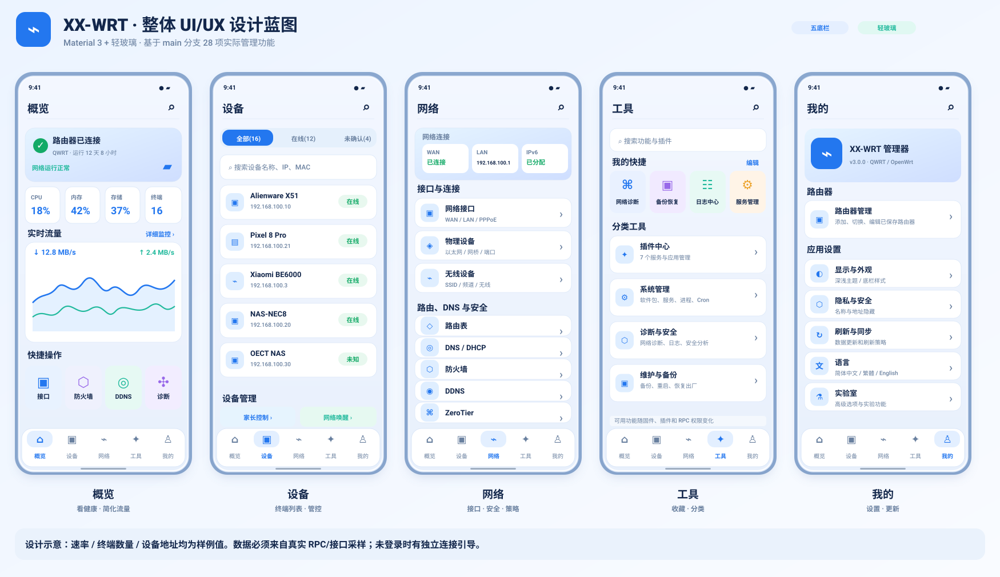
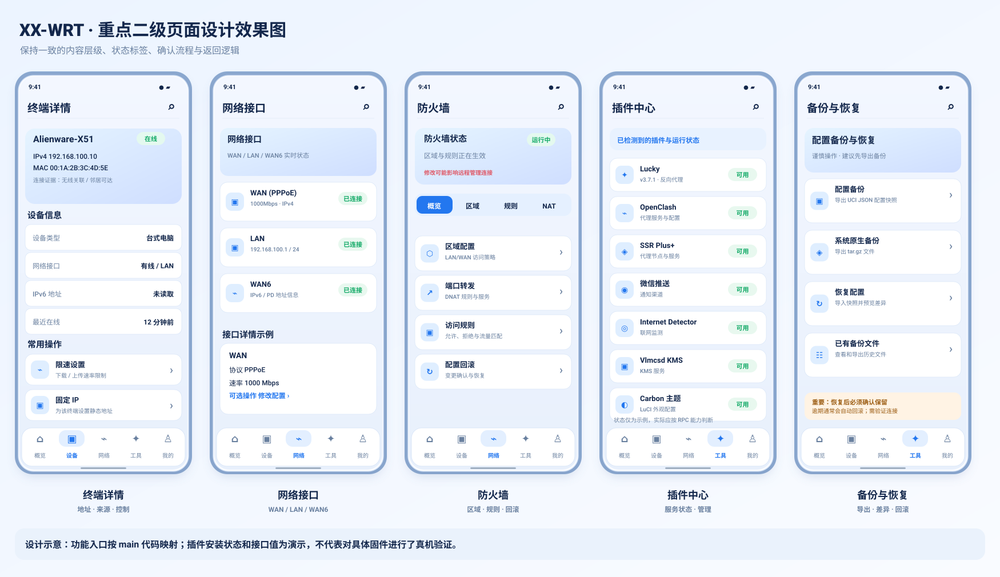

# XX-WRT 管理器 · 整体 UI/UX 重设计方案 A

> **设计交付物，不是运行截图，也不是功能已实施的声明。** 基于 GitHub `main` 的提交 [`10a06af2a0`](https://github.com/lmdbot/xxwrt-m-custom/commit/10a06af2a02c5b867064f7b37464c1b65f8d726f)（2026-11-17 审阅）与用户提供的「Material + 轻玻璃」设计参考。仅新增 `doc/`，不改变 Android、Vue 或构建逻辑。

## 设计目标

把应用由「大量功能堆在同一页面」调整为以 **看状态 → 找设备 → 配网络 → 用工具 → 管应用** 为主线的层级式信息架构。设计选择：

- **五个底部栏目**：概览、设备、网络、工具、我的。第二栏明确为「设备」，它指**连接路由器的终端**，不是已保存的路由器列表。
- **概览简化曲线 + 独立详细监控**；首页只保留最有用的设备状态和四项快捷操作。
- **工具常用快捷入口 + 分类列表**；28 项真实功能保留原有 RPC/UCI 的能力边界。
- **Material 3 + 轻玻璃**：主要信息用高对比度实色卡片，玻璃感只用于导航和少量顶部容器；深浅色主题均有独立样式。
- **信息密度均衡**：重要操作前置，复杂配置按二级/三级页面组织；默认手机基准 360–430dp。

## 文档导航

| 文件 | 内容 |
| --- | --- |
| [01-现状审计与功能归属](01-current-state-audit.md) | `main` 源码核查、28 项功能迁移表、主要 UX 痛点 |
| [02-信息架构与导航图](02-information-architecture.md) | 一级/二级/三级站点地图、进入/返回/跨栏目交互 |
| [03-页面级 UI/UX 说明](03-page-specifications.md) | 五个主页面、11 类重点二级页面的布局与状态 |
| [04-设计系统](04-design-system.md) | 色板、排版、尺寸、组件、深浅色与适配 |
| [05-交互与安全规范](05-interactions-and-states.md) | 搜索、加载、失败、风险操作、权限/离线及状态模型 |
| [06-实施计划与验收](06-delivery-plan.md) | 阶段任务、代码映射、测试与验收标准 |
| [效果图：五个主页面](visuals/primary-pages.svg) | SVG 高保真示意（示例数据，非真实运行截图） |
| [效果图：重点二级页面](visuals/secondary-pages.svg) | SVG 高保真示意（示例数据） |
| [导航结构可视化](visuals/navigation-map.svg) | 可在 GitHub 中直接查看的 SVG |
| [交互预览 HTML](prototype.html) | 无构建依赖的本地可交互原型（离线打开） |

## 设计执行边界

1. `docs/` 继续保留已有历史、发布记录与功能对照，不替换；本方案独立保存至用户指定的 `doc/`。
2. 不根据参考图里的“12.8 MB/s、16 台、已安装数量”等示例数字推导真机能力或假设真实接口。
3. `main` 中存在「路由器列表（登录前）→ 已选路由器工作区（登录后）」的状态差异；本方案保留登录前后能力边界。未连接状态的设备/网络/工具应显示明确引导，不可假装已接入。
4. 某些功能需插件或 ACL；**不可读、不可用、未安装、离线、正在检测**必须分别显示。
5. 界面结构与素材是后续研发基准；实施时仍需以现网 QWRT/OpenWrt RPC、UCI 返回、Android 真机以及自动化测试为准。

## 快速预览

## 验收口径

设计确认≠代码完成；代码完成≠真机验证。每项后续实现应标注：`设计已定 / 前端已实现 / 模拟 RPC 已验证 / 真机已验证`，不得相互混用。
